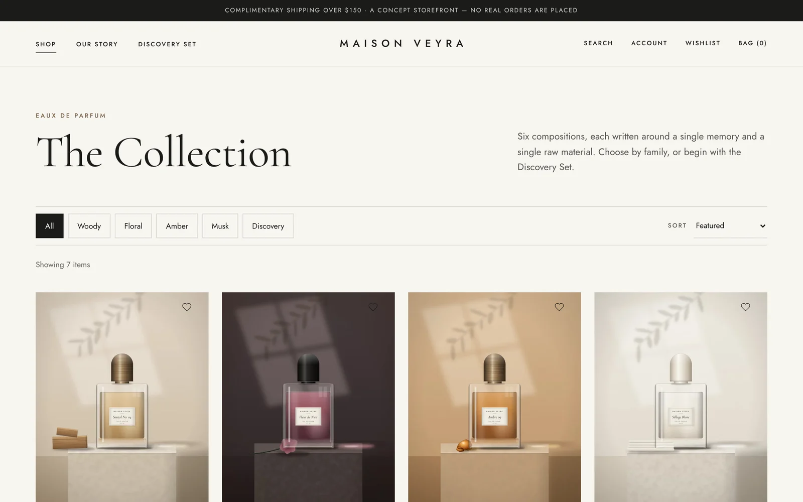

# Maison Veyra — Luxury Fragrance Storefront

A complete, working e-commerce concept for a fictional niche perfume house, built to show how a premium fragrance brand can be designed and engineered end to end: editorial art direction, product discovery, product pages with size variants, bag, wishlist, account, and a checkout architecture ready for a real payment provider.

> **This is a concept.** Maison Veyra is a fictional brand. No products are sold, no payments are taken, and nothing is shipped. Simulated features are labelled as such inside the site.

**Live demo:** _add the Vercel URL after deploying — see [Deploy](#deploy)_

| Desktop | Mobile |
| --- | --- |
|  |  |
|  |  |



---

## What works

| Area | Details |
| --- | --- |
| **Homepage** | Art-directed campaign hero (separate desktop and mobile crops), signature collection, editorial brand story, interactive scent finder, Discovery Set, brand philosophy, newsletter with validation |
| **Collection** | Filter by fragrance family, sort by price or name, URL-synced state (`/shop?family=floral&sort=price-asc`), hover image swap, quick add, wishlist, mobile filter sheet |
| **Product page** | Gallery (editorial stack on desktop, swipe carousel on mobile, full-screen viewer), 30 / 50 / 100 ml sizes that update price and the bag variant, quantity, notes pyramid, descriptive character scale, story, shipping & returns, related fragrances, Product JSON-LD |
| **Search** | Overlay search across names, families, notes and moods (accent-insensitive: "iris poudre" finds *Iris Poudré*) |
| **Bag** | Drawer and full page; change size or quantity, remove, free-shipping progress, totals, persistence via `localStorage`, empty states |
| **Wishlist** | Save / remove from any card or product page, choose a size and add to bag, persistence, empty state |
| **Checkout** | Four steps — contact, address, shipping method, payment & review — with inline validation; order created by a server route that **recomputes prices from the catalogue**; confirmation page |
| **Account** | Sign in / create account / demo account, overview, order history (orders placed in the demo appear here) |
| **Our Story** | Editorial long-read with asymmetric layouts |
| **Client care** | Shipping, Returns, Contact, FAQ, Privacy, Terms — every footer link resolves |
| **SEO** | Per-page titles and descriptions, Open Graph image, canonical URLs, `sitemap.xml`, `robots.txt`, Product structured data, true `404` for unknown products |
| **Accessibility** | Semantic landmarks, skip link, labelled forms with error messages, keyboard-operable dialogs (focus trap, Escape, focus return), visible focus, reduced-motion support |

## Demo limitations — what is simulated

| Feature | In this demo | For production |
| --- | --- | --- |
| Payment | **Simulated provider.** No card fields exist on the site; nothing is charged. A Stripe Checkout (test mode) provider is implemented and switches on with `STRIPE_SECRET_KEY=sk_test_…`, but it **has not been run against Stripe** in this project because no keys were available. | Stripe / PayPal / regional gateway via the `PaymentProvider` interface, plus a webhook to mark orders paid. |
| Accounts | **Simulated session in `localStorage`.** Nothing is verified; passwords are never stored or sent. | Auth.js, Clerk, or Shopify customer accounts. |
| Orders | Stored in the visitor's browser only. A sample order history appears for the demo account and is labelled "sample data". | Database or commerce backend (Shopify, Medusa, commercetools…). |
| Newsletter | Validated, then confirms without storing the address. | Klaviyo / Mailchimp / Customer.io. |
| Products & copy | Fictional brand, products, prices and policies. | Client catalogue, ideally from a CMS or commerce API. |
| Imagery | Original art-directed renders (see below), not photographs. | The client's product photography, dropped into `public/images`. |
| Social links | Shown as text ("accounts linked at launch"). | Real profile URLs. |

## Tech stack

- **Next.js 16** (App Router, React 19, Cache Components / Partial Prerendering, Proxy) and **TypeScript**
- **Tailwind CSS v4** with design tokens in `src/app/globals.css`
- **Zustand** for bag, wishlist, orders and demo session (persisted)
- **Motion** for the drawer, menu, search and lightbox — loaded only when an overlay first opens
- **Lucide** icons, used sparingly
- **Playwright** for end-to-end tests
- Fonts: **Cormorant Garamond** and **Jost** (both SIL Open Font License) via `next/font`

## Project structure

```
src/
  app/                    routes (home, shop, fragrances/[slug], bag, checkout, wishlist,
                          account, our-story, info/[slug], api/checkout, sitemap, robots)
  components/
    layout/               header, footer, search, mobile menu, lazy overlays
    home/ shop/ product/  page sections
    cart/ checkout/ account/ wishlist/
    ui/                   buttons, reveal, quantity stepper, wishlist button, demo note
  config/brand.ts         ← rebranding starts here: name, nav, shipping rules, contact
  data/                   products, families, client-care pages, sample account
  lib/                    catalog queries, pricing, search, scent finder, SEO, payments/
  store/                  Zustand stores
  hooks/                  dialog behaviour, hydration, add-to-bag
  types/                  shared TypeScript types
  proxy.ts                returns a real 404 for unknown product / info slugs
scripts/art/              the image pipeline (see below)
tests/e2e/                Playwright journeys
```

Product data is never written inside JSX: pages read typed objects from `src/data`, and prices live in one place (cents) with a single `computeTotals()` used by the bag, the checkout summary and the server.

## Payment architecture

```
Browser (bag lines: slug + variant + qty)
   └─► POST /api/checkout
         ├─ validates email, address, shipping method, items, quantities
         ├─ recomputes subtotal / shipping / tax from the catalogue (browser prices ignored)
         └─ getPaymentProvider()
               ├─ simulated  → { kind: "confirmed" }               (default)
               └─ stripe     → Stripe Checkout Session → { kind: "redirect", url }
```

Adding PayPal or a regional gateway means implementing one `PaymentProvider` in `src/lib/payments/`. Card data is designed never to touch this application — payment happens on the provider's hosted page.

## Imagery — original art pipeline

No stock photography or other brands' imagery is used. Every product and editorial image is an original still life (bottle, cap, liquid, stone plinths, window light, botanical shadows, raw materials) described in code in `scripts/art/` and rendered to WebP:

```bash
npm run art            # render all 27 images into public/images
npm run art -- ambre   # re-render only matching scenes
```

All scenes share one light direction and colour grade, so the catalogue reads as a single shoot. For launch, replace the files in `public/images` with the client's photography — filenames are referenced from `src/data/products.ts`.

## Run locally

Requires Node.js 20.9+ (developed on Node 22).

```bash
npm install
```

```bash
npm run dev
```

Open http://localhost:3000. Optionally copy `.env.example` to `.env.local`.

### Scripts

| Command | Purpose |
| --- | --- |
| `npm run dev` | Development server |
| `npm run build` / `npm start` | Production build / server |
| `npm run lint` | ESLint (Next.js config, React Compiler rules) |
| `npm run typecheck` | TypeScript, no emit |
| `npm run test:e2e` | Playwright journeys on desktop (1440 px) and mobile (360 px); builds must exist (`npm run build` first) |
| `npm run art` | Re-render the art-directed imagery |

### Environment variables

| Variable | Required | Purpose |
| --- | --- | --- |
| `NEXT_PUBLIC_SITE_URL` | No | Canonical origin for metadata, sitemap and JSON-LD. On Vercel it falls back to the production domain automatically. |
| `STRIPE_SECRET_KEY` | No | A Stripe **test** secret key (`sk_test_…`) enables Stripe Checkout in test mode. Any other value is ignored. |

## Verification

Results from the final build of this repository:

- `npm run lint` — no errors or warnings
- `npm run typecheck` — passes
- `npm run build` — passes; every page prerendered (product and client-care pages statically generated)
- `npm run test:e2e` — **21 passed** (11 journeys × desktop + mobile; one mobile-only test skipped on desktop): homepage → collection, filters and sorting, size → price → bag variant, quantity and size changes in the bag with tax and shipping, persistence across reload, wishlist, search, full simulated checkout through to account order history, API price-tampering rejection, newsletter validation, mobile navigation and no horizontal overflow on 10 pages at 360 px, true 404, and no console errors throughout.
- **Lighthouse 12.8** (mobile emulation, local production server, single run each):

  | Page | Performance | Accessibility | Best Practices | SEO |
  | --- | --- | --- | --- | --- |
  | `/` | 93 | 100 | 100 | 100 |
  | `/fragrances/santal-no-04` | 94 | 100 | 100 | 100 |
  | `/shop` | 94 | 98 | 100 | 100 |
  | `/our-story` | 94 | 100 | 100 | 100 |

  CLS was 0 on every page. Scores on a hosted deployment will differ with network and CDN conditions; re-measure on the live URL before quoting them. (`/checkout`, `/bag`, `/account` and `/wishlist` are deliberately `noindex`.)

## Deploy

[](https://vercel.com/new/clone)

1. Push this repository to GitHub.
2. In Vercel, **Add New → Project**, import the repository. The framework preset (Next.js) is detected; no build settings need changing.
3. Optionally add `STRIPE_SECRET_KEY` (test key) under **Settings → Environment Variables**.
4. Deploy. The site needs no login to view.

Or with the CLI:

```bash
npx vercel --prod
```

---

## Client Presentation

### The visual concept
Maison Veyra is imagined as a small, serious fragrance house whose idea is memory — *fragrance as the trace you leave behind*. The identity is built from three quiet elements: warm ivory and stone neutrals with a single bronze accent; a high-contrast editorial serif (Cormorant Garamond) set against a clean geometric sans (Jost) with generous letter-spacing; and an **arch** motif — the bottle cap, the doorway in the editorial imagery — standing for a remembered room. Every image is lit from the same window, so the whole site feels like one photographic shoot.

### How it expresses luxury
Luxury here comes from restraint rather than decoration: large, unhurried typography, real whitespace, no badges, countdowns or pop-ups, and motion used only where it helps — a slow settle on the hero, a short rise as sections enter, a measured drawer. The copy is written as a house would write it, not as marketing.

### How customers discover fragrances
Several paths lead to the right bottle: browsing by **family** (woody, floral, amber, musk); a three-question **scent finder** on the homepage that recommends a fragrance and explains why; **search** by note or mood ("vanilla", "smoky", "warm"); and the **Discovery Set**, presented as the natural first purchase, with its price credited toward a full bottle. Each product page explains a fragrance the way a perfumer would — a notes pyramid, a descriptive character scale (clearly marked as guidance, not measurement) and the story behind it.

### The shopping experience
Choosing a size updates the price and bottle illustration immediately; adding to the bag opens a drawer that confirms exactly what was added and shows progress toward complimentary shipping. The bag allows size changes without starting over. Wishlists persist between visits.

### Checkout architecture
Checkout is four short steps with inline validation. Orders are created on the server, which ignores any prices sent by the browser and recalculates totals from the catalogue. Payment is behind a small provider interface: the demo uses a clearly labelled simulated provider, and a Stripe Checkout (test mode) provider is already written and switches on with an environment variable. Card details are never collected by the site itself.

### Mobile
Mobile layouts were designed separately, not shrunk: a dedicated vertical crop of the campaign image, a swipe gallery on product pages, a bottom-sheet filter, a full-screen menu, comfortable 44 px touch targets, and no horizontal scrolling — verified automatically at 360 px.

### Making it yours
Brand name, navigation, shipping rules and contact details live in `src/config/brand.ts`; colours and type in one token file; products in a typed data file that can later be replaced by Shopify, a headless commerce API or a CMS without touching the page components. Your photography replaces the rendered imagery file for file.

### What remains for a production launch
- Real payment processing (Stripe or preferred gateway) with webhooks, refunds and receipts
- Real authentication and customer accounts
- Order management, inventory and fulfilment — usually via Shopify, or a headless commerce backend
- CMS for products, editorial content and policies
- Transactional and marketing email
- Legal pages, cookie consent and accessibility statement reviewed for your markets
- Analytics, internationalisation and multi-currency if required
- Your product photography, final copy and brand assets

---

*Maison Veyra is fictional and was created as a design and engineering demonstration. It is not a past client project.*
